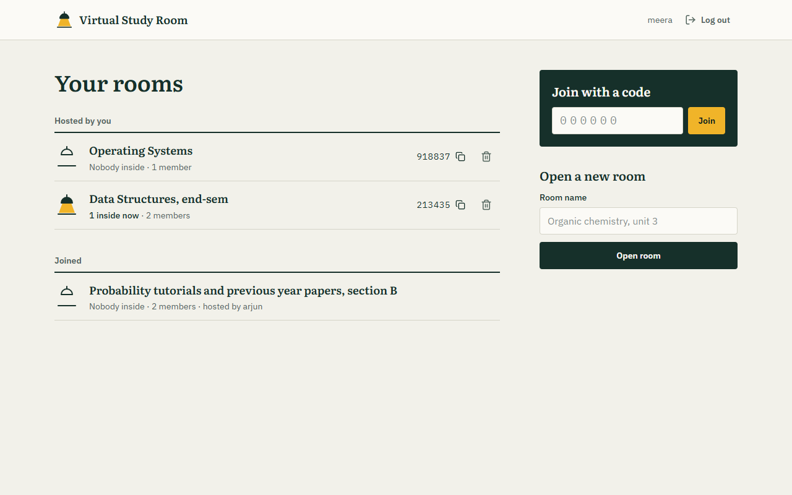
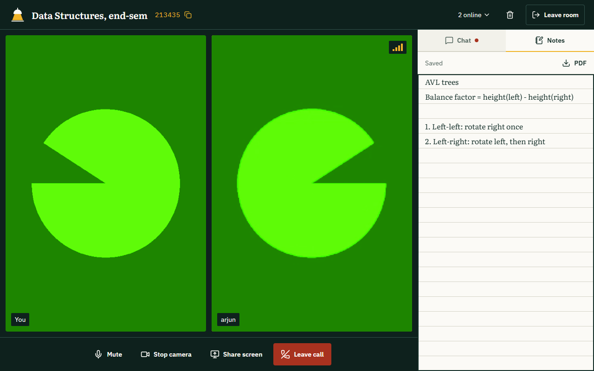

# Virtual Study Room

A web app for studying together: video calls, chat, file sharing and shared notes in private rooms.





## Features

- **Private rooms.** A 6-digit code makes you a member. Only members can open a room or read its data.
- **Video calls** for up to six people, with screen sharing. A camera or microphone is optional.
- **Chat** with history, file sharing (10 MB, checked by content) and retry for messages that fail to send.
- **Shared notes** that merge simultaneous typing, sync after a dropped connection, and print or save as PDF in any language.
- **Presence.** A room's desk lamp is lit on your dashboard while someone is inside.

## How it works

| Part | Technology |
|---|---|
| Frontend | React 19, React Router, Tailwind CSS, Vite |
| Backend | Node.js, Express 5, Socket.IO |
| Database | MongoDB with Mongoose; files in GridFS |
| Notes | Yjs (CRDT) |
| Video | WebRTC, peer to peer |
| Tests | Jest and Supertest (backend), Vitest and Testing Library (frontend) |

```
backend/
  server.js             starts HTTP and Socket.IO
  src/routes            URLs, validation, rate limits
  src/controllers       HTTP request and response
  src/services          business logic and database access
  src/models            User, Room, Message
  src/socket            authentication, event handlers, presence
  tests/
frontend/
  src/api               HTTP client
  src/hooks             sockets, chat, notes, media, WebRTC
  src/components        screens and shared pieces
  src/context           login state, dialogs and notices
```

Design decisions worth knowing:

- **Yjs for notes.** Sending the whole text on each edit would let one person overwrite another. Yjs merges edits instead.
- **GridFS for files.** Hosts such as Railway and Render can wipe the server's disk on redeploy. GridFS keeps files with the data and lets the API check membership on each download.
- **Mesh video.** Each browser sends video to every other, so no media server is needed. That is why calls are limited to six.
- **Identity comes from the token.** Sockets are authenticated on connection; names and IDs in event payloads are ignored.

## Run it locally

You need Node.js 22 or later, and MongoDB running on your machine or on Atlas.

```bash
cd backend
npm install
cp .env.example .env      # then set MONGODB_URI and JWT_SECRET
npm run dev
```

Generate a secret with:

```bash
node -e "console.log(require('crypto').randomBytes(48).toString('hex'))"
```

In a second terminal:

```bash
cd frontend
npm install
cp .env.example .env.development
npm start
```

Open http://localhost:3000. To try it alone, sign in as a second user in another browser.

## Tests

```bash
cd backend && npm test
cd frontend && npm test && npm run lint && npm run build
```

The first backend run downloads a temporary MongoDB (about 800 MB).

## API

All routes except register, login and health need `Authorization: Bearer <token>`.

| Method and path | Purpose | Who |
|---|---|---|
| `POST /api/auth/register` | Create an account | Anyone |
| `POST /api/auth/login` | Log in | Anyone |
| `GET /api/auth/me` | Current user | Logged in |
| `POST /api/rooms` | Create a room | Logged in |
| `GET /api/rooms` | Your rooms, with how many are inside | Logged in |
| `POST /api/rooms/join` | Join with a code | Logged in |
| `GET /api/rooms/:id` | Room details | Members |
| `POST /api/rooms/:id/leave` | Give up membership | Members except the host |
| `DELETE /api/rooms/:id` | Delete a room and its data | Host |
| `GET /api/rooms/:id/messages?before=` | Messages, newest page first | Members |
| `POST /api/rooms/:id/files` | Upload a file | Members |
| `GET /api/rooms/:id/files/:fileId` | Download a file | Members |
| `GET /api/health` | Health check | Anyone |

Socket events: `join-room`, `leave-room`, `chat-message`, `notes-open`, `notes-update`, `join-call`, `leave-call`, `media-state`, `video-offer`, `video-answer`, `ice-candidate`. From the server: `presence`, `room-deleted`, `membership-ended`, `call-joined`, `call-left`.

## Known limits

- One backend server only: presence and open notes are kept in memory.
- Calls need a TURN server on networks that block direct connections (see [DEPLOYMENT.md](DEPLOYMENT.md)).
- The login token is kept in localStorage, so a script injected into the page could read it. There is no password reset or email verification.
